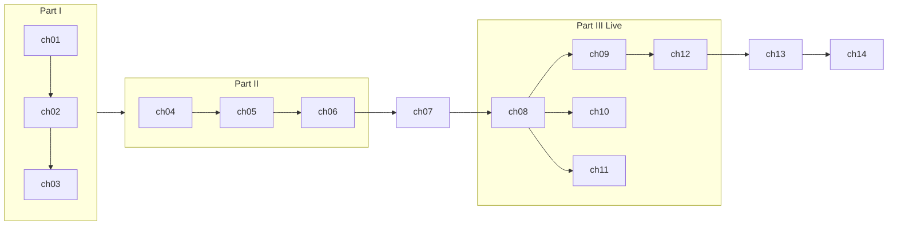

# Chapter map (hypothesis)

**Status:** Stage C — architecture only, no manuscript. **G3 approved** — see [`research/foundation-gates.md`](../research/foundation-gates.md).

**Drafting rule:** One chapter at a time in Stage E, only after G1–G4 approval. Each chapter must satisfy the [contribution test](#contribution-test).

**Master outline (sections + dual-track beats):** [`CHAPTER_PLAN.md`](CHAPTER_PLAN.md) — plan chapters here before drafting ch02+.

**Reading order:** Follow the table below (author decision 2026-10-18). Chapter **IDs** (`ch08`, `ch07`, …) stay stable for briefs and claims; **read #** is the manuscript order.

## Reading order and sequence

| Read # | ID | Working title | Thematic part | Brief |
| ---: | --- | --- | --- | --- |
| 1 | ch01 | The deal you’re making with your dog | I — Mindset | [`briefs/ch01.md`](briefs/ch01.md) |
| 2 | ch02 | How dogs actually learn | I | [`briefs/ch02.md`](briefs/ch02.md) |
| 3 | ch03 | Your toolkit: rewards, markers, and setup | I | [`briefs/ch03.md`](briefs/ch03.md) |
| 4 | ch04 | The teaching loop | II — Teach | [`briefs/ch04.md`](briefs/ch04.md) |
| 5 | ch05 | Cues, criteria, and when to raise the bar | II | [`briefs/ch05.md`](briefs/ch05.md) |
| 6 | ch06 | Progression without pressure | II | [`briefs/ch06.md`](briefs/ch06.md) |
| 7 | ch07 | Reading stress (without playing vet) | Understand *(before Live)* | [`briefs/ch07.md`](briefs/ch07.md) |
| 8 | ch08 | Engagement and the name game | III — Live | [`briefs/ch08.md`](briefs/ch08.md) |
| 9 | ch09 | Settle and calm at home | III | [`briefs/ch09.md`](briefs/ch09.md) |
| 10 | ch10 | Recall: coming back when it matters | III | [`briefs/ch10.md`](briefs/ch10.md) |
| 11 | ch11 | Walking together on a lead | III | [`briefs/ch11.md`](briefs/ch11.md) |
| 12 | ch12 | Doors, guests, and gentle handling | III | [`briefs/ch12.md`](briefs/ch12.md) |
| 13 | ch13 | Puppies, teenagers, and rescue dogs | Life stages | [`briefs/ch13.md`](briefs/ch13.md) |
| 14 | ch14 | When it goes wrong — and when to call for help | V — Limits | [`briefs/ch14.md`](briefs/ch14.md) |

**Why ch07 moves up:** Part III skills (recall, lead, doors) need **comfort / stress literacy** before owners practise them under real-world pressure (Phase 2 foundation challenge, P0-1).

## Learning arc

## Contribution test

Each brief must document:

1. **Unique contribution** — what the reader gains that prior chapters did not provide  
2. **Practical outcome** — observable behaviour or decision capability  
3. **claim_ids** — from `research/source-register.md` (no E5 without plan)  
4. **welfare_risk** — none \| moderate \| serious  
5. **app_sources** — optional Good Dog exercise IDs (adaptation only)  

## Dependencies

| Chapter | Must follow (reading order) | Notes |
| --- | --- | --- |
| ch04 | ch01–ch03 | Installs **teaching loop** |
| ch06 | ch04–ch05 | **Five checks** preview; full stall diagnosis in ch14 |
| ch07 | ch01–ch06 | **Before** Part III Live |
| ch08–ch12 | **ch07**, ch04–ch06 | Live skills; use comfort check from ch07 |
| ch10 | ch08 | §3 blocked until qualified review |
| ch11 | ch08, ch03; **§3 blocked** | Qualified review before loose-lead mechanics |
| ch13 | ch07 | Life stages; puppy §1 E5 until review |
| ch14 | All prior | Systematises **five checks** + referral |

## Explicit non-chapters

Good Dog exercises are **not** chapter titles. Topics handled only as sidebars or omitted: shop/kit, app onboarding, planner algorithms, guest auth, push reminders.
