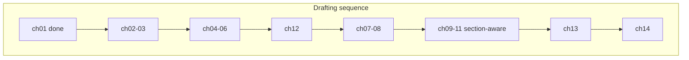

# Chapter plan (master outline)

**Status:** Stage C/E planning document — **plan before draft** for ch02–ch14.  
**Read order:** [`CHAPTER_MAP.md`](CHAPTER_MAP.md). **Per-chapter maintainer detail:** [`briefs/chNN.md`](briefs/).  
**Evidence readiness:** [`research/chapter-coverage-matrix.md`](../research/chapter-coverage-matrix.md).

**Drafting convention:** Every major section uses **Train yourself** / **Train the dog** with **Know / Do / Don't** ([`writing/dual-track-pattern.md`](../writing/dual-track-pattern.md)). **Train yourself** emphasises patience and not training while frustrated.

**Target length (first pass):** ~4–6k words per chapter unless brief notes otherwise; ch01 v1 ~2k (expand at revision).

---

## Book arc (what the reader experiences)

| Part | Read # | Chapters | Reader shift |
| --- | --- | --- | --- |
| **I — Mindset** | 1–3 | ch01–ch03 | Contract, learning theory, toolkit — “I can set this up.” |
| **II — Teach** | 4–6 | ch04–ch06 | Loop, criteria, progression — “I can teach without drilling.” |
| **Understand (early)** | 7 | **ch12** | Stress literacy — “I notice comfort before live skills.” |
| **III — Live** | 8–12 | ch07–ch11 | Real life — “I can practise with stop rules.” |
| **Life stages** | 13 | ch13 | Puppy / teen / rescue — “I adjust expectations.” |
| **V — Limits** | 14 | ch14 | Five checks + referral — “I know when to stop and who to call.” |

---

## Read #1 — ch01 The deal you’re making with your dog

| | |
| --- | --- |
| **Status** | **Draft v1** — [`manuscript/ch01-the-deal.md`](../manuscript/ch01-the-deal.md) |
| **Outcome** | Fair contract; manage/teach/vet split; TTH + dual-track frame; read order |
| **Claims** | `claim-imdt-001-force-free`, `book-research-defra-001-reward-based`, E4 mantra |

**Sections (as drafted):** Opening → good dog → limits of training → Training the Human → dual-track how-to → loop/check names → how to use book → troubleshooting/stop → bridge ch02.

**Revision backlog:** Lengthen if needed; optional reflective one-liner under §3 only (guidance, not fixed template block).

---

## Read #2 — ch02 How dogs actually learn

| | |
| --- | --- |
| **Outcome** | Consequences beat lectures; timing; “stubborn” retired |
| **Claims** | `claim-dt-pr-001-definition`, `claim-imdt-002-no-pp-nr`, `book-research-defra-002-avoid-harsh`; optional Hiby (E1, E3 tone) |
| **Welfare** | moderate |
| **Bridge in** | ch01 contract → “how learning works” |
| **Bridge out** | ch03 toolkit |

### Section plan

1. **Dogs learn what works — consequences, not lectures**  
   - *Train yourself:* Know reinforcement is about **your** consistency; Do pay for what you want; Don't nag like a lecture.  
   - *Train the dog:* Know behaviour follows payoff; Do repeat what got paid; Don't expect moral understanding.

2. **Markers, rewards, and the gap between behaviour and emotion**  
   - *Self:* Know marker = camera shutter for behaviour; Do one marker system; Don't mark late because you were on your phone.  
   - *Dog:* Know emotion ≠ disobedience; Do separate “scared” from “hasn't learned”; Don't train through shutdown.

3. **Individual differences and realistic timelines (E3/E4)**  
   - *Self:* Know comparison breeds impatience; Do one dog one plan; Don't timeline from TikTok.  
   - *Dog:* Know breed/age/history matter; Do small steps; Don't flood to “socialise.”

**Practice lab (optional):** 60-second “what got rewarded?” observation in the garden — no new skill.

---

## Read #3 — ch03 Your toolkit: rewards, markers, and setup

| | |
| --- | --- |
| **Outcome** | 3-minute session anywhere sensible; reward menu for *this* dog today |
| **Claims** | `claim-dt-marker-001-charge-marker`, `claim-abtc-003-no-aversives`, `claim-rspca-002-short-sessions` |
| **App adapt** | `ex-reward-marker`, `ex-engagement-easy` |

### Section plan

1. **Reward menus (food, play, access)**  
   - *Self:* Know value changes by context; Do rank rewards before session; Don't bribe after refusal.  
   - *Dog:* Know payday drives effort; Do discover “jackpot”; Don't only kibble when steak is needed.

2. **Marker word or click — mechanics without frenzy**  
   - *Self:* Know charge marker before behaviour; Do quiet marker; Don't click storm.  
   - *Dog:* Know sound predicts pay; Do 10–15 charge reps; Don't pair marker with scary handling.

3. **Where to train first; management when the world is too loud**  
   - *Self:* Know environment is half the lesson; Do baby steps; Don't “proof” on the high street day one.  
   - *Dog:* Know success in quiet first; Do hallway before park; Don't learn failure loops in chaos.

**Practice lab:** Charge marker + one easy sit or hand touch — stop at 3–5 wins.

---

## Read #4 — ch04 The teaching loop

| | |
| --- | --- |
| **Outcome** | Teach sit or hand target via full loop without over-drilling |
| **Claims** | `claim-dt-marker-*`, `claim-dt-pr-003`, `claim-rspca-005`, `book-claim-owner-mantra` |
| **Install** | Mantra + **five checks** named (full table ch14) |

### Section plan (dual-track mandatory)

1. **Loop in prose** — setup → cue → behaviour → mark/reward → release → reset  
2. **Splitting criteria** — one thing per session; lure → cue fade preview  
3. **When nothing happens** — five checks + **“Make it easier — then ask again.”**

**Practice lab:** Full loop sit or hand target; stop while eager.

---

## Read #5 — ch05 Cues, criteria, and when to raise the bar

| | |
| --- | --- |
| **Outcome** | One-line success criterion; when *not* to add duration/distraction |
| **Claims** | `claim-rspca-005`, `claim-dt-pr-002-continuous-reinforcement-new-skill` |

### Section plan

1. **One cue, one meaning** — poisoned cues; self: cue once; dog: cue = opportunity  
2. **Duration, distance, distraction — pick one** — self: impatience adds three variables; dog: one dimension at a time  
3. **Generalisation without telepathy** — shrink world; self: proof is a plan; dog: new place = new lesson  

**Practice lab:** Same behaviour, one generalisation step (e.g. different room).

---

## Read #6 — ch06 Progression without pressure

| | |
| --- | --- |
| **Outcome** | Bad session without escalation; modest next steps |
| **Claims** | `claim-imdt-003-referral`, `claim-dt-pr-004`, shrink-world E4 |

### Section plan

1. **Consolidation beats novelty** — self: boredom ≠ need new trick; dog: fluency needs reps  
2. **Setbacks: environment, health, adolescence** — self: don't train angry; vet preview  
3. **Simplify vs refer** — preview ch14; self: referral is success  

**Practice lab:** “Two good reps and out” rule on a known skill.

---

## Read #7 — ch12 Reading stress (without playing vet)

| | |
| --- | --- |
| **Outcome** | Cluster-based stress signs; stop/simplify; no single-pixel diagnosis |
| **Claims** | `book-research-defra-002`, `book-claim-ch12-stress-charity` (+ Blue Cross/PDSA at draft) |
| **Amber** | Clinical boundary copy; charity URLs |
| **Critical** | **Before** ch07–ch11 drafting voice for comfort check |

### Section plan

1. **What stress looks like (clusters)** — self: believe the dog; dog: stress is information  
2. **Your dog vs the internet chart** — self: context; dog: no guilt labels  
3. **Stop, simplify, manage** — links comfort check in five checks; bridge Part III  

**No practice lab** — observation exercise: 5-minute calm watch, note clusters, no training.

---

## Read #8 — ch07 Engagement and the name game

| | |
| --- | --- |
| **Outcome** | Engagement + name = orient; stop rules for worry |
| **Claims** | `claim-dt-recall-001`, `book-research-name-page-001` |
| **Prereq** | ch12 comfort lens |

### Section plan

1. **Engagement games** — self: play not drill; dog: approach pays  
2. **Name = check-in, not nag** — self: say once; dog: name predicts good stuff  
3. **Mild distraction — criteria and abort** — align with ch09; self: shrink world; dog: success at current level  

**Practice lab:** Name game 10 reps, stop early.

---

## Read #9 — ch08 Settle and calm at home

| | |
| --- | --- |
| **Outcome** | Mat settle + rest spot with stop conditions |
| **Claims** | `claim-rspca-002`, reward-based settle E4 |

### Section plan

1. **Mat as landing pad** — invited settle; self: duration slowly; dog: mat = pay for calm  
2. **Calm around movement** — honest expectations; self: don't punish alertness  
3. **Rest spot and choice to leave** — dog chooses exit; self: manage kids/door chaos  

**Practice lab:** Mat settle 3 reps; release to sniff.

---

## Read #10 — ch09 Recall: coming back when it matters

| | |
| --- | --- |
| **Outcome** | Foundation recall + long-line plan; **§3 blocked until review** |
| **Claims** | `claim-dt-recall-003`, `004`, `005`, `claim-dt-escape-001` |
| **Welfare** | serious |
| **Red** | **§3** distraction/off-lead progression — [`e5-reviewer-questions.md`](../research/e5-reviewer-questions.md) |

### Section plan

1. **Foundation recall** — cheerful call; never punish late return; *self:* bank trust; *dog:* come = jackpot + release  
2. **Long lines, secure areas, UK management** — legal ID mention; no off-lead bravado  
3. **Distraction — RED / placeholder** — draft only after reviewer sign-off; until then: pointer to management + ch14  

**Practice lab:** Indoor/garden recall only in v1 manuscript.

---

## Read #11 — ch10 Walking together on a lead

| | |
| --- | --- |
| **Outcome** | Short reinforced segments; equipment comfort |
| **Red** | **§3** `book-claim-loose-lead-method` E5 — no mechanics until review |
| **Welfare** | serious |

### Section plan

1. **Equipment and comfort** — harness/collar neutral; no pain kit  
2. **Introducing lead/harness positively** — conditioned positive association  
3. **Soft-lead mechanics — BLOCKED** — stub: “management + check-ins until professional review”  
4. **Real walks** — environment, check-ins, end early; *self:* walk isn't a treadmill  

**Practice lab:** §1–2 only until §3 cleared.

---

## Read #12 — ch11 Doors, guests, and gentle handling

| | |
| --- | --- |
| **Outcome** | Door management; **management-first greetings**; handling touches |
| **Red** | **§2** expansion beyond management-first  
| **Welfare** | serious |

### Section plan

1. **Doors — safety before politeness** — gates, leashes, not rank  
2. **Greetings — management-first only** — distance, one helper optional, abort on stiffening; **no** flooding protocol  
3. **Handling for vet/groom prep** — choice, short touches, stop; growl-not-punish safety  

**Practice lab:** Door setup checklist (management), not guest choreography.

---

## Read #13 — ch13 Puppies, teenagers, and rescue dogs

| | |
| --- | --- |
| **Outcome** | Stage-appropriate expectations; same method, different tempo |
| **Red** | **§1** puppy socialisation/sounds E5 until review |
| **Welfare** | serious |

### Section plan

1. **Puppies** — toilet, mouthing; exposure principles **without** E5 protocol detail until review  
2. **Adolescent regression** — normal chaos; mantra + shrink world  
3. **Rescue settling** — decompression, safety, refer early  

**Practice lab:** Stage-specific (e.g. mouthing redirect OR decompression schedule) — one per life stage sidebar.

---

## Read #14 — ch14 When it goes wrong — and when to call for help

| | |
| --- | --- |
| **Outcome** | Full **five checks** table; vet-first; ABTC/IMDT as public signposts |
| **Claims** | `claim-abtc-001`, `claim-imdt-003`, `claim-rspca-003`, `004` |
| **Includes** | Multi-dog household mention (management only) |

### Section plan

1. **Troubleshooting the loop** — systematic five checks + mantra  
2. **Vet first** — pain, sudden change, appetite, medical rule-outs  
3. **Trainers vs behaviourists** — unregulated UK market; citation independence  
4. **What this book never replaces** — limits, companion app optional pointer  

**No practice lab** — decision trees and referral copy.

---

## Section-red summary (do not draft until cleared)

| Chapter | Section | Action |
| --- | --- | --- |
| ch09 | §3 | Qualified review → owner steps + stop rules |
| ch10 | §3 | E5 loose-lead method sign-off |
| ch11 | §2 | Stay management-first; expand after review |
| ch13 | §1 | Puppy socialisation/sounds framing after review |

---

## Recommended drafting order

1. ~~ch01~~ (done)  
2. **ch02 → ch03** — complete Part I  
3. **ch04 → ch05 → ch06** — Part II  
4. **ch12** — before any Part III prose  
5. **ch07 → ch08** — low red risk  
6. **ch09 §1–2, ch10 §1–2 & §4, ch11 §1 & §3** — skip reds  
7. **ch13 §2–3** before §1 if §1 still E5  
8. **ch14** — after enough Part III exists to reference  
9. **Red sections** — after [`editorial/qualified-review-plan.md`](../editorial/qualified-review-plan.md)  

---

## When this plan changes

Update this file and the matching `briefs/chNN.md` when sections move, claims change, or review clears a red block. Log material changes in [`research/decision-register.md`](../research/decision-register.md).
